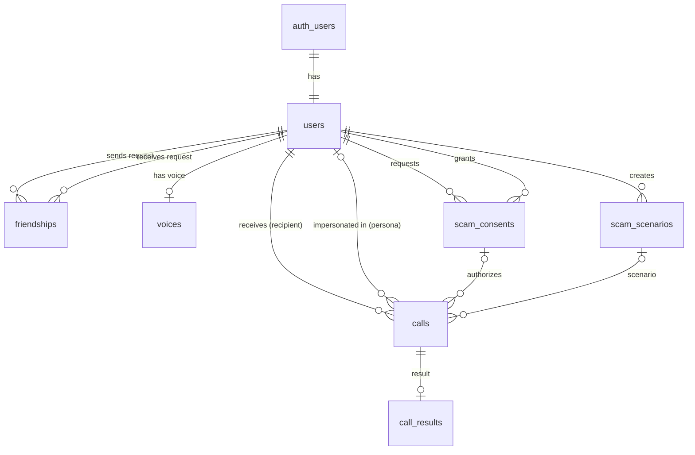

# Database Schema (Draft / Mock)

> Status: **Draft, pending team review**. Updated for the friends and consent-based direction.
>
> The SQL below is applied by the migrations in [`migrations/`](migrations/), which are the source
> of truth. When the schema changes, add a new migration and update this document to match (see
> [README.md](README.md)).

Database: **Supabase (Postgres)**. Auth: **Supabase Auth** (`auth.users`). The frontend signs users
up and in (email and password; no other providers for now) directly with Supabase, and sends
the resulting access token (a JWT) to the backend, which verifies it. The backend has no login or
registration endpoints and there is no session table in our schema. See
[docs/authentication.md](../docs/authentication.md).
Binary files (voice samples, any files the voice pipeline derives from them, call recordings) live in **Supabase Storage**,
and the tables only store the storage path.

---

## 1. Overview

| Table | Purpose | Main endpoints |
|---|---|---|
| `auth.users` | Managed by Supabase Auth (email, password hash) | None (Supabase Auth on the client) |
| `users` | App-level profile for each user (name, ID verification, onboarding answers) | `finishOnboarding`, `VerifyUser`, `getUserInfo`, `editUserInfo` |
| `friendships` | Friend requests and accepted friendships between two users | `sendFriendRequest`, `acceptFriendRequest`, `declineFriendRequest`, `getFriendsList`, `removeFriend` |
| `voices` | Each user's own voice reference sample for Chatterbox | `uploadVoiceSample`, `getVoice`, `deleteVoice` |
| `scam_consents` | Time-limited permission from a friend to use their profile and voice | `RequestConsent`, `AcceptConsent`, `DeclineConsent`, `getConsents` |
| `scam_scenarios` | Built-in and user-created scam scripts the AI pipeline uses | `addScenario`, `removeScenario`, `UpdateScenario` |
| `calls` | One row per simulated scam call | `GetCallHistory`, `GetCallDetails` |
| `call_results` | Post-call score, summary and feedback | `GetCallDetails` |

### Entity relationships



### How a call is authorized

Users practise on themselves. In this example, Alex and Sam are two users. Alex wants to practise
spotting a scam that uses a clone of their friend Sam's voice:

1. Alex sends a `RequestConsent` request for Sam, which creates a `pending` row in `scam_consents`.
2. Sam accepts through `AcceptConsent`. The row becomes `accepted`, and `expires_at` is set to a
   short time from now. Or Sam declines through `DeclineConsent`, and the row becomes `declined`.
3. `getConsents` returns Alex's accepted consents that have not been used or expired.
4. Alex chooses which consenting friend to use (here, Sam) and a scenario. The AI then holds the
   simulated call with Alex, using Sam's voice and profile. Simulated calls do not go through the
   phone network.

On a simulated call, `user_id` is Alex (who receives the call) and `persona_user_id` is Sam (who is
being impersonated).

Before starting a simulated call, the backend must check that the consent is `accepted`, unused
and not expired, that the two users are still friends, and that Sam's voice is `ready`, then mark
the consent used. `use_consent` in `backend/app/modules/consents/service.py` does all of this.

---

## 2. Enums

```sql
-- No 'declined': declining a request or removing a friend deletes the row.
create type friendship_status as enum ('pending', 'accepted');

create type consent_status as enum ('pending', 'accepted', 'declined', 'revoked');  -- 'revoked': migration 0002

create type voice_status as enum ('uploaded', 'training', 'ready', 'failed');

create type scam_category as enum (
  'grandparent_emergency', 'executive_impersonation', 'bank_fraud_alert',
  'government_agency', 'tech_support', 'romance', 'prize_lottery', 'other'
);

create type call_status as enum ('queued', 'in_progress', 'completed', 'failed', 'canceled');

create type call_outcome as enum (
  'recognized_scam',      -- hung up / called it out / verified identity
  'partially_complied',   -- shared some info but stopped before money/credentials
  'fully_complied',       -- agreed to send money or shared sensitive info
  'inconclusive'          -- call too short to grade
);
```

---

## 3. Tables

### `users`

One row per Supabase Auth user who has finished onboarding. Sign-up goes straight from the frontend
to Supabase, and only the backend writes to this table (see [Row Level Security](#4-row-level-security)),
so `finishOnboarding`, the first backend call after sign-up, creates the row with the username,
first and last name and privacy policy acceptance. A signed-in user with no row has not finished
onboarding, and `getUserInfo` returns `404` for them.

We keep this table instead of relying on `auth.users` alone because:

- The `auth` schema is not exposed through Supabase's API, and we must not expose other users'
  emails anyway. Friends find each other by `username` and see `first_name`/`last_name` from this table.
- Every other table references `users(id)`, so a user must have a profile before they can add
  friends, train a voice or receive calls.
- Supabase `user_metadata` can be changed by the user themselves (`supabase.auth.updateUser`), so
  it cannot hold trusted fields such as `verified_at`. This table is written only by the backend
  (see [Row Level Security](#4-row-level-security)).

```sql
create table public.users (
  id                        uuid primary key references auth.users(id) on delete cascade,
  username                  text unique not null,  -- how friends find each other
  first_name                text not null,
  last_name                 text not null,
  preferred_language        text not null default 'en',
  verified_at               timestamptz,           -- null = ID not verified (VerifyUser)
  -- Answers used to tailor the scenario. Null if never given or removed by the user.
  -- e.g. {"city": "Toronto", "pet_name": "Max", "school": "UofT"}
  onboarding_answers        jsonb,
  privacy_policy_version    text not null,
  privacy_policy_accepted_at timestamptz not null,
  created_at                timestamptz not null default now(),
  updated_at                timestamptz not null default now()
);
```

Notes:

- Email and password are in `auth.users`, not duplicated here.
- There is no "onboarding completed" column: the row only exists once onboarding is finished, so
  `created_at` is when it finished. Removing onboarding answers through `editUserInfo` sets
  `onboarding_answers` to null but keeps the row, so the user is not sent back through onboarding.
- ID documents are not stored here. `verified_at` only records that verification passed.

### `friendships`

One row per pair of users, whichever of them sent the request.

- `sendFriendRequest` inserts a `pending` row.
- `acceptFriendRequest` sets it to `accepted`, which puts each user on the other's friends list.
- `declineFriendRequest` and `removeFriend` delete the row, so the users can send a new request later.

```sql
create table public.friendships (
  id            uuid primary key default gen_random_uuid(),
  requester_id  uuid not null references public.users(id) on delete cascade,
  addressee_id  uuid not null references public.users(id) on delete cascade,
  status        friendship_status not null default 'pending',
  created_at    timestamptz not null default now(),
  accepted_at   timestamptz,
  check (requester_id <> addressee_id)
);

-- Only one row per pair, in either direction
create unique index friendships_pair_idx on public.friendships (
  least(requester_id, addressee_id), greatest(requester_id, addressee_id)
);
create index friendships_requester_id_idx on public.friendships(requester_id);
create index friendships_addressee_id_idx on public.friendships(addressee_id);
```

### `voices` (uploadVoiceSample)

One voice per user. Chatterbox is pretrained and clones a voice from a reference recording, so there
is no per-user training: the user uploads a reference sample of their own voice
(`PUT /api/v1/users/me/voice`), and uploading again replaces it, deletes the old files and resets
`status` to `uploaded`. What the voice pipeline derives from the sample, if anything
(`model_storage_path`), and when it sets `ready`, is TBD. Only the owner's own voice is ever
uploaded. Friends get access through `scam_consents`, and never receive any file.

```sql
create table public.voices (
  id                    uuid primary key default gen_random_uuid(),
  user_id               uuid unique not null references public.users(id) on delete cascade,
  sample_storage_path   text,                      -- Supabase Storage: voice-samples/{user_id}/{upload_id}.{ext}
  sample_duration_seconds numeric(6,2),
  model_storage_path    text,                      -- Supabase Storage: voice-models/..., if the pipeline derives a file (TBD)
  status                voice_status not null default 'uploaded',
  error_message         text,
  -- User confirms the sample is their own voice and agrees to it being cloned
  voice_owner_consent_at timestamptz not null,
  created_at            timestamptz not null default now(),
  updated_at            timestamptz not null default now()
);
```

### `scam_consents` (RequestConsent, AcceptConsent, DeclineConsent, getConsents)

Each consent covers **one call**. `expires_at` is set when the consent is accepted, and `used_at`
(added in draft migration `0003_single_use_consents.sql`) when a call starts with it. The expiry
stops a requester holding an unused consent until the consenter has forgotten giving it. Expiry is
worked out by comparing `expires_at` to the current time, so no scheduled job is needed. An
available consent is one where `status = 'accepted' and used_at is null and expires_at > now()`.
The consenter can revoke an accepted, unused consent, which sets its status to `revoked` (a value
added by migration 0002). Each consent belongs to the friendship it was requested under (`friendship_id`, also migration
0002), so removing the friend deletes the consents in the same statement, and becoming friends
again never revives them.

```sql
create table public.scam_consents (
  id            uuid primary key default gen_random_uuid(),
  requester_id  uuid not null references public.users(id) on delete cascade,  -- who will receive the call
  consenter_id  uuid not null references public.users(id) on delete cascade,  -- whose profile and voice are used
  friendship_id uuid not null references public.friendships(id) on delete cascade,  -- migration 0002
  status        consent_status not null default 'pending',
  requested_at  timestamptz not null default now(),
  responded_at  timestamptz,
  expires_at    timestamptz,
  used_at       timestamptz,                     -- set when a call starts with it (migration 0002)
  check (requester_id <> consenter_id),
  check (status <> 'accepted' or expires_at is not null),
  check (used_at is null or status = 'accepted')
);

-- Only one unanswered request at a time for each requester and friend
create unique index scam_consents_one_pending_idx on public.scam_consents(requester_id, consenter_id)
  where status = 'pending';
create index scam_consents_requester_id_idx on public.scam_consents(requester_id, status);
create index scam_consents_consenter_id_idx on public.scam_consents(consenter_id, status);
create index scam_consents_friendship_id_idx on public.scam_consents(friendship_id);
create index scam_consents_usable_idx on public.scam_consents(requester_id, expires_at)
  where status = 'accepted' and used_at is null;
```

### `scam_scenarios` (addScenario, removeScenario, UpdateScenario)

Rows with a null `created_by` are built-in scenarios managed by the team. Users can only edit or
delete scenarios they created, and those scenarios are visible only to their creator.

```sql
create table public.scam_scenarios (
  id              uuid primary key default gen_random_uuid(),
  created_by      uuid references public.users(id) on delete cascade,  -- null = built-in
  title           text not null,
  category        scam_category not null,
  difficulty      smallint not null default 2 check (difficulty between 1 and 3),
  description     text not null,                   -- shown to the user when choosing a scenario
  system_prompt   text not null,                   -- OpenAI prompt for the scammer agent
  red_flags       jsonb not null default '[]'::jsonb, -- ["urgency", "secrecy request", "gift cards"]
  max_duration_seconds int not null default 300,
  is_active       boolean not null default true,
  created_at      timestamptz not null default now(),
  updated_at      timestamptz not null default now()
);

create index scam_scenarios_created_by_idx on public.scam_scenarios(created_by);
```

### `calls` (GetCallHistory, GetCallDetails)

`consent_id`, `persona_user_id` and `scenario_id` are nullable so that call history survives when
those rows are deleted. The backend requires all three when it creates a call.

```sql
create table public.calls (
  id                    uuid primary key default gen_random_uuid(),
  user_id               uuid not null references public.users(id) on delete cascade,  -- who receives the call
  persona_user_id       uuid references public.users(id) on delete set null,          -- who is impersonated
  consent_id            uuid references public.scam_consents(id) on delete set null,
  scenario_id           uuid references public.scam_scenarios(id) on delete set null,
  -- snapshots so history still reads well if a user or scenario is deleted
  persona_name          text not null,
  scenario_title        text not null,
  status                call_status not null default 'queued',
  started_at            timestamptz,
  ended_at              timestamptz,
  duration_seconds      int,
  recording_storage_path text,                     -- optional; subject to retention policy
  failure_reason        text,
  created_at            timestamptz not null default now()
);

create index calls_user_id_created_at_idx on public.calls(user_id, created_at desc);
create index calls_persona_user_id_idx on public.calls(persona_user_id);
create index calls_consent_id_idx on public.calls(consent_id);
create index calls_scenario_id_idx on public.calls(scenario_id);
```

### `call_results` (GetCallDetails)

```sql
create table public.call_results (
  call_id             uuid primary key references public.calls(id) on delete cascade,
  outcome             call_outcome not null,
  score               smallint not null check (score between 0 and 100),
  summary             text not null,
  did_well            jsonb not null default '[]'::jsonb,   -- ["Asked a personal question only the real person would know"]
  to_improve          jsonb not null default '[]'::jsonb,   -- ["Agreed to keep the call secret"]
  red_flags_noticed   jsonb not null default '[]'::jsonb,
  red_flags_missed    jsonb not null default '[]'::jsonb,
  sensitive_info_shared boolean not null default false,
  model_version       text,                                  -- which OpenAI model/prompt graded it
  created_at          timestamptz not null default now()
);
```

### `updated_at` trigger

`users`, `voices` and `scam_scenarios` have an `updated_at` column. A trigger sets it on every
update, so the backend never has to.

```sql
create function public.set_updated_at()
returns trigger
language plpgsql
set search_path = ''
as $$
begin
  new.updated_at = now();
  return new;
end;
$$;

create trigger users_set_updated_at
  before update on public.users
  for each row execute function public.set_updated_at();
create trigger voices_set_updated_at
  before update on public.voices
  for each row execute function public.set_updated_at();
create trigger scam_scenarios_set_updated_at
  before update on public.scam_scenarios
  for each row execute function public.set_updated_at();
```

---

## 4. Row Level Security

All writes go through the FastAPI backend, which uses the **service role key** after checking the
user's JWT. Clients get read-only policies, and only when signed in (`to authenticated`), so
anonymous requests made with just the publishable key can read nothing. This stops a user from
using their own JWT to write directly to Supabase and, for example, set their own `verified_at`,
accept a consent on a friend's behalf, or mark a voice as `ready`.

```sql
alter table public.users          enable row level security;
alter table public.friendships    enable row level security;
alter table public.voices         enable row level security;
alter table public.scam_consents  enable row level security;
alter table public.scam_scenarios enable row level security;
alter table public.calls          enable row level security;
alter table public.call_results   enable row level security;

-- users: a user can only read their own row (this includes onboarding answers)
create policy "own user (read)" on public.users
  for select to authenticated using (id = auth.uid());

-- friendships / consents: readable by either user involved
create policy "own friendships (read)" on public.friendships
  for select to authenticated using (auth.uid() in (requester_id, addressee_id));
create policy "own consents (read)" on public.scam_consents
  for select to authenticated using (auth.uid() in (requester_id, consenter_id));

-- voices / calls: owned directly by user_id
create policy "own voice (read)" on public.voices
  for select to authenticated using (user_id = auth.uid());
create policy "own calls (read)" on public.calls
  for select to authenticated using (user_id = auth.uid());

-- child table: owned through its parent
create policy "own call results (read)" on public.call_results
  for select to authenticated
  using (exists (select 1 from public.calls c
                 where c.id = call_id and c.user_id = auth.uid()));

-- scenarios: any signed-in user can read active built-in scenarios and their own
create policy "read scenarios" on public.scam_scenarios
  for select to authenticated
  using ((created_by is null and is_active) or created_by = auth.uid());
```

Friends cannot read each other's `users` rows through RLS, because policies apply to whole rows and
would expose onboarding answers. `getFriendsList` returns only the safe fields
through the backend.

### Storage buckets

| Bucket | Path | Access |
|---|---|---|
| `voice-samples` (private) | `{user_id}/{upload_id}.wav` (PCM WAV for now) | backend only; never sent to a client |
| `voice-models` (private) | `{user_id}/...` | backend only; never sent to a client |

Draft migration `0004_voice_storage_buckets.sql` creates the two voice buckets. They have no
`storage.objects` policies, so clients cannot read or write them; the backend uses the secret key.
Each upload gets a new `upload_id`, so a failed upload never overwrites the sample the database
points to. After a successful upload, the backend deletes the replaced sample and anything derived from it.
Deleting the voice deletes its files, then the row (so a failed attempt can be retried). Both also
delete leftovers of failed requests: unreferenced files in the user's folders older than 10
minutes (a newer one may belong to an upload still saving its record).
| `call-recordings` (private) | `{user_id}/{call_id}.mp3` | owner only; deleted after retention period |

---

## 5. Data retention & deletion (proposal)

- **Delete user** cascades to their friendships, voice, consents, scenarios and the calls they
  received. The backend also deletes their files from Storage. On other users' calls that
  impersonated them, `persona_user_id` and `consent_id` become null and only the `persona_name`
  snapshot remains.
- **Remove friend** deletes the `friendships` row, and with it every consent between the two users
  (`friendship_id ... on delete cascade`). Past calls keep their snapshots; `consent_id` becomes null.
- **Delete scenario** sets `scenario_id` to null on past calls, which keep the `scenario_title`
  snapshot.
- **Call recordings**: deleted after 30 days (scheduled job). Results are kept until the user deletes
  them.
- **Voice samples**: kept until the user replaces or deletes their voice
  (`DELETE /api/v1/users/me/voice`, which deletes the files, then the row, then older leftovers;
  it can be repeated until it succeeds). A file left by a failed request is deleted on the user's
  next upload or delete. **TBD:** a scheduled sweep for users who never come back. **TBD:** whether
  the sample can be deleted once the pipeline is `ready`; with zero-shot cloning the pipeline may
  need it for every call.

---

## 6. Endpoint to table mapping

Every endpoint requires a valid Supabase access token. Sign-up and sign-in are not backend endpoints;
the frontend calls Supabase Auth directly, which writes `auth.users`.

| Endpoint | Reads | Writes |
|---|---|---|
| `POST VerifyUser` | `users` | `users.verified_at` |
| `POST finishOnboarding` | `users` | `users` (creates the row: `username`, `first_name`/`last_name` copied from Supabase `user_metadata`, privacy policy acceptance, `onboarding_answers`) |
| `GET getUserInfo` | `users`, `voices` | – |
| `PUT editUserInfo` | `users` | `users` (not `verified_at`) |
| `POST sendFriendRequest` | `users`, `friendships` | `friendships` |
| `POST acceptFriendRequest` | `friendships` | `friendships` (addressee only) |
| `POST declineFriendRequest` | `friendships` | `friendships` (deletes row; addressee only) |
| `GET getFriendsList` | `friendships`, `users` (safe fields) | – |
| `DEL removeFriend` | `friendships` | `friendships` (deletes row) |
| `POST RequestConsent` | `friendships`, `voices` | `scam_consents` |
| `POST AcceptConsent` | `scam_consents`, `friendships` | `scam_consents` (consenter only; sets `expires_at`) |
| `POST DeclineConsent` | `scam_consents` | `scam_consents` (consenter only) |
| `GET getConsents` | `scam_consents`, `users` (safe fields) | – |
| `GET GetCallHistory` | `calls`, `call_results` (score/outcome) | – |
| `GET GetCallDetails` | `calls`, `call_results` | – |
| `PUT uploadVoiceSample` | `voices` | Storage, `voices` |
| `GET getVoice` | `voices` | – |
| `DEL deleteVoice` | `voices` | Storage, `voices` (deletes row) |
| `POST addScenario` | – | `scam_scenarios` |
| `PUT UpdateScenario` | `scam_scenarios` | `scam_scenarios` (creator only) |
| `DEL removeScenario` | `scam_scenarios` | `scam_scenarios` (creator only) |
| Call pipeline (backend) | `calls` | `calls`, `call_results` |

---
