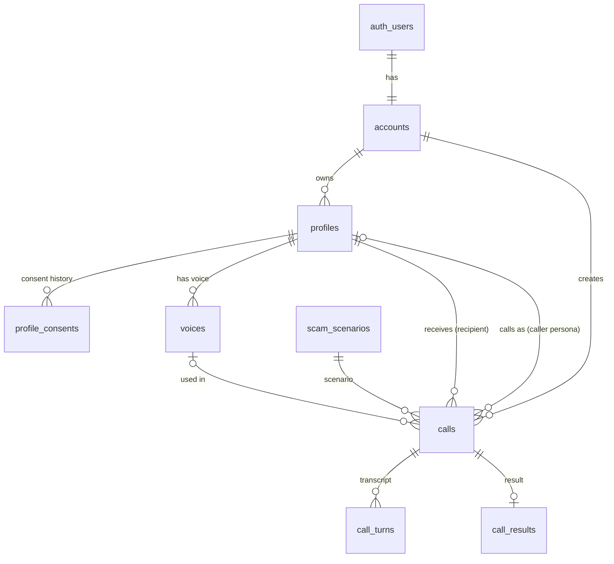

# Database Schema (Draft / Mock)

> Status: **draft for team review**. This is a starting point for the Database & Design
> specification milestone. Names, enums and columns are open for discussion.

Database: **Supabase (Postgres)**. Auth: **Supabase Auth** (`auth.users`).
Binary files (voice samples, call recordings) live in **Supabase Storage**, and the tables
only store the storage path.

---

## 1. Overview

| Table | Purpose | Main endpoints |
|---|---|---|
| `auth.users` | Managed by Supabase Auth (email, password hash, sessions) | `Login`, `Register` |
| `accounts` | App-level data for each user (name, privacy policy acceptance, settings) | `Register` |
| `profiles` | People under an account: family members, employees, or the user themself. A profile can **receive** calls and/or be the **persona a call comes from** | `GetProfiles`, `AddProfile`, `EditProfile`, `DeleteProfile` |
| `profile_consents` | Consent records for a profile's phone number. Calls are only allowed to verified, consenting numbers | `AuthenticateProfile` |
| `voices` | Cloned voices (ElevenLabs), each attached to a profile | `trainVoice` |
| `scam_scenarios` | Catalog of scam types and scripts the AI pipeline uses | `CreateCall` (picked when creating a call) |
| `calls` | One row per simulated scam call | `CreateCall`, `GetCallHistory`, `GetCallDetails` |
| `call_turns` | Transcript of a call, one row per utterance | `GetCallDetails` |
| `call_results` | Post-call score, summary and feedback | `GetCallDetails` |

### Entity relationships



### How "calling as" a profile works

A call has two profile references:

- `recipient_profile_id`: who gets the phone call (for example, Grandma). Must have active consent.
- `caller_profile_id` (optional): the persona the scammer pretends to be (for example, the grandchild).
  If that profile has a ready voice, the user can choose to use it (`voice_id`). If not, a stock
  ElevenLabs voice is used.

---

## 2. Enums

```sql
create type profile_relationship as enum (
  'self', 'parent', 'grandparent', 'child', 'grandchild', 'sibling',
  'spouse_partner', 'other_family', 'friend', 'employee', 'coworker', 'manager', 'other'
);

create type consent_status as enum ('pending', 'granted', 'declined', 'revoked', 'expired');

create type consent_method as enum ('sms_reply', 'verification_link', 'voice_keypress');

create type voice_status as enum ('uploaded', 'training', 'ready', 'failed', 'deleted');

create type scam_category as enum (
  'grandparent_emergency', 'executive_impersonation', 'bank_fraud_alert',
  'government_agency', 'tech_support', 'romance', 'prize_lottery', 'other'
);

create type call_status as enum (
  'queued', 'ringing', 'in_progress', 'completed', 'no_answer', 'busy', 'failed', 'canceled'
);

create type call_speaker as enum ('ai_caller', 'recipient', 'system');

create type call_outcome as enum (
  'recognized_scam',      -- hung up / called it out / verified identity
  'partially_complied',   -- shared some info but stopped before money/credentials
  'fully_complied',       -- agreed to send money or shared sensitive info
  'inconclusive'          -- call too short or no answer
);
```

---

## 3. Tables

### `accounts`

One row per Supabase Auth user, created at registration.

```sql
create table public.accounts (
  id                        uuid primary key references auth.users(id) on delete cascade,
  display_name              text not null,
  account_type              text not null default 'individual'
                              check (account_type in ('individual', 'family', 'organization')),
  organization_name         text,
  privacy_policy_version    text not null,
  privacy_policy_accepted_at timestamptz not null,
  created_at                timestamptz not null default now(),
  updated_at                timestamptz not null default now()
);
```

Notes: email and password are in `auth.users`, not duplicated here.

### `profiles`

```sql
create table public.profiles (
  id                uuid primary key default gen_random_uuid(),
  account_id        uuid not null references public.accounts(id) on delete cascade,
  full_name         text not null,
  nickname          text,                          -- what the persona would be called ("Grandma", "Bobby")
  relationship      profile_relationship not null default 'other',
  phone_number      text check (phone_number ~ '^\+[1-9][0-9]{6,14}$'),  -- E.164 format
  preferred_language text not null default 'en',
  -- Surface-level personal details used to tailor the scenario. Keep minimal (privacy).
  -- e.g. {"city": "Toronto", "pet_name": "Max", "school": "UofT"}
  personal_details  jsonb not null default '{}'::jsonb,
  notes             text,
  created_at        timestamptz not null default now(),
  updated_at        timestamptz not null default now(),
  unique (account_id, phone_number)
);

create index profiles_account_id_idx on public.profiles(account_id);
```

### `profile_consents` (AuthenticateProfile)

Proposed practical flow:

1. User adds a profile with a phone number, then calls `AuthenticateProfile` (POST).
2. Backend creates a `pending` row and sends a Twilio SMS to that number: _"[Name] wants to send you
   practice scam calls through <App>. Reply YES to agree, or STOP to decline."_ (or a one-time link).
3. The Twilio webhook (or link) updates the row to `granted` / `declined`.
4. `CreateCall` checks for a `granted`, non-expired, non-revoked consent before dialing.
5. The recipient can text STOP at any time, which sets the consent to `revoked`.

Consent should **not** say when the call will happen (so the practice call stays realistic), but it
must make clear the recipient agrees to receive simulated calls.

```sql
create table public.profile_consents (
  id                uuid primary key default gen_random_uuid(),
  profile_id        uuid not null references public.profiles(id) on delete cascade,
  phone_number      text not null,                 -- number that consented (snapshot)
  status            consent_status not null default 'pending',
  method            consent_method not null default 'sms_reply',
  verification_token_hash text,                    -- for link-based consent; store the hash only
  twilio_message_sid text,
  requested_at      timestamptz not null default now(),
  responded_at      timestamptz,
  expires_at        timestamptz,                   -- e.g. consent valid for 12 months
  revoked_at        timestamptz
);

create index profile_consents_profile_id_idx on public.profile_consents(profile_id);
```

### `voices` (trainVoice)

```sql
create table public.voices (
  id                    uuid primary key default gen_random_uuid(),
  account_id            uuid not null references public.accounts(id) on delete cascade,
  profile_id            uuid not null references public.profiles(id) on delete cascade,
  label                 text,                      -- e.g. "Bobby - phone recording"
  sample_storage_path   text not null,             -- Supabase Storage: voice-samples/{account_id}/{voice_id}.wav
  sample_duration_seconds numeric(6,2),
  elevenlabs_voice_id   text unique,               -- set once training completes
  status                voice_status not null default 'uploaded',
  error_message         text,
  -- Owner of the voice must agree to it being cloned
  voice_owner_consent_at timestamptz not null,
  created_at            timestamptz not null default now(),
  updated_at            timestamptz not null default now()
);

create index voices_profile_id_idx on public.voices(profile_id);
```

### `scam_scenarios`

Shared, read-only catalog (managed by the team, not by users).

```sql
create table public.scam_scenarios (
  id              uuid primary key default gen_random_uuid(),
  slug            text unique not null,            -- e.g. 'grandchild-bail'
  title           text not null,
  category        scam_category not null,
  difficulty      smallint not null default 2 check (difficulty between 1 and 3),
  description     text not null,                   -- shown to the user when creating a call
  system_prompt   text not null,                   -- OpenAI prompt for the scammer agent
  red_flags       jsonb not null default '[]'::jsonb, -- ["urgency", "secrecy request", "gift cards"]
  max_duration_seconds int not null default 300,
  is_active       boolean not null default true,
  created_at      timestamptz not null default now()
);
```

### `calls` (CreateCall, GetCallHistory)

```sql
create table public.calls (
  id                    uuid primary key default gen_random_uuid(),
  account_id            uuid not null references public.accounts(id) on delete cascade,
  recipient_profile_id  uuid references public.profiles(id) on delete set null,
  caller_profile_id     uuid references public.profiles(id) on delete set null,
  voice_id              uuid references public.voices(id) on delete set null,
  scenario_id           uuid not null references public.scam_scenarios(id),
  -- snapshots so history still reads well if a profile is deleted
  recipient_name        text not null,
  recipient_phone_number text not null,
  twilio_call_sid       text unique,
  status                call_status not null default 'queued',
  scheduled_for         timestamptz,               -- null = call now (supports monthly practice later)
  started_at            timestamptz,
  ended_at              timestamptz,
  duration_seconds      int,
  recording_storage_path text,                     -- optional; subject to retention policy
  failure_reason        text,
  created_at            timestamptz not null default now()
);

create index calls_account_id_created_at_idx on public.calls(account_id, created_at desc);
create index calls_recipient_profile_id_idx on public.calls(recipient_profile_id);
```

### `call_turns` (transcript)

```sql
create table public.call_turns (
  id            bigint generated always as identity primary key,
  call_id       uuid not null references public.calls(id) on delete cascade,
  turn_index    int not null,
  speaker       call_speaker not null,
  text          text not null,
  started_ms    int,                               -- offset from call start
  latency_ms    int,                               -- AI response latency (for perf testing)
  created_at    timestamptz not null default now(),
  unique (call_id, turn_index)
);
```

### `call_results` (GetCallDetails)

```sql
create table public.call_results (
  call_id             uuid primary key references public.calls(id) on delete cascade,
  outcome             call_outcome not null,
  score               smallint not null check (score between 0 and 100),
  summary             text not null,
  did_well            jsonb not null default '[]'::jsonb,   -- ["Asked a personal question only the real person would know"]
  to_improve          jsonb not null default '[]'::jsonb,   -- ["Agreed to keep the call secret"]
  red_flags_noticed   jsonb not null default '[]'::jsonb,
  red_flags_missed    jsonb not null default '[]'::jsonb,
  sensitive_info_shared boolean not null default false,
  model_version       text,                                  -- which OpenAI model/prompt graded it
  created_at          timestamptz not null default now()
);
```

---

## 4. Row Level Security

The FastAPI backend uses the **service role key** for pipeline work (Twilio webhooks, writing
transcripts/results). RLS still protects direct client access and any queries made with the
user's JWT.

```sql
alter table public.accounts         enable row level security;
alter table public.profiles         enable row level security;
alter table public.profile_consents enable row level security;
alter table public.voices           enable row level security;
alter table public.scam_scenarios   enable row level security;
alter table public.calls            enable row level security;
alter table public.call_turns       enable row level security;
alter table public.call_results     enable row level security;

-- accounts: a user can only see/edit their own row
create policy "own account" on public.accounts
  for all using (id = auth.uid()) with check (id = auth.uid());

-- profiles / voices / calls: owned directly by account_id
create policy "own profiles" on public.profiles
  for all using (account_id = auth.uid()) with check (account_id = auth.uid());
create policy "own voices" on public.voices
  for all using (account_id = auth.uid()) with check (account_id = auth.uid());
create policy "own calls (read)" on public.calls
  for select using (account_id = auth.uid());

-- child tables: owned through their parent
create policy "own consents (read)" on public.profile_consents
  for select using (exists (select 1 from public.profiles p
                            where p.id = profile_id and p.account_id = auth.uid()));
create policy "own call turns (read)" on public.call_turns
  for select using (exists (select 1 from public.calls c
                            where c.id = call_id and c.account_id = auth.uid()));
create policy "own call results (read)" on public.call_results
  for select using (exists (select 1 from public.calls c
                            where c.id = call_id and c.account_id = auth.uid()));

-- scenarios: any signed-in user can read active scenarios
create policy "read active scenarios" on public.scam_scenarios
  for select to authenticated using (is_active);
```

Writes to `calls`, `profile_consents`, `call_turns` and `call_results` go through the backend only
(no insert/update policies for clients).

### Storage buckets

| Bucket | Path | Access |
|---|---|---|
| `voice-samples` (private) | `{account_id}/{voice_id}.wav` | owner only |
| `call-recordings` (private) | `{account_id}/{call_id}.mp3` | owner only; deleted after retention period |

---

## 5. Data retention & deletion (proposal)

- **Delete profile** cascades to its consents and voices. The backend also deletes the voice from
  ElevenLabs and the sample from Storage. Past calls stay, but `recipient_profile_id` is set to null
  and keep only the name/number snapshot. (Open question: should we also scrub the phone number?)
- **Delete account** cascades to everything under `accounts`.
- **Call recordings**: deleted after 30 days (scheduled job). Transcripts and results are kept until
  the user deletes them.
- **Voice samples**: deleted from Storage once ElevenLabs training is `ready`.

---

## 6. Endpoint to table mapping

| Endpoint | Reads | Writes |
|---|---|---|
| `POST /register` | – | `auth.users` (Supabase), `accounts` |
| `POST /login` | `auth.users` (Supabase) | – |
| `GET /profiles` | `profiles`, latest `profile_consents`, `voices` | – |
| `POST /profiles` | – | `profiles` |
| `PUT /profiles/{id}` | `profiles` | `profiles` (changing the phone number resets consent) |
| `DELETE /profiles/{id}` | `voices` | `profiles` (cascade) |
| `POST /profiles/{id}/consent` | `profiles` | `profile_consents` |
| `POST /voices` (trainVoice) | `profiles` | Storage, `voices` |
| `POST /calls` | `profiles`, `profile_consents`, `voices`, `scam_scenarios` | `calls` |
| `GET /calls` | `calls`, `call_results` (score/outcome) | – |
| `GET /calls/{id}` | `calls`, `call_turns`, `call_results` | – |
| Twilio webhooks | `calls` | `calls`, `call_turns`, `call_results`, `profile_consents` |

---